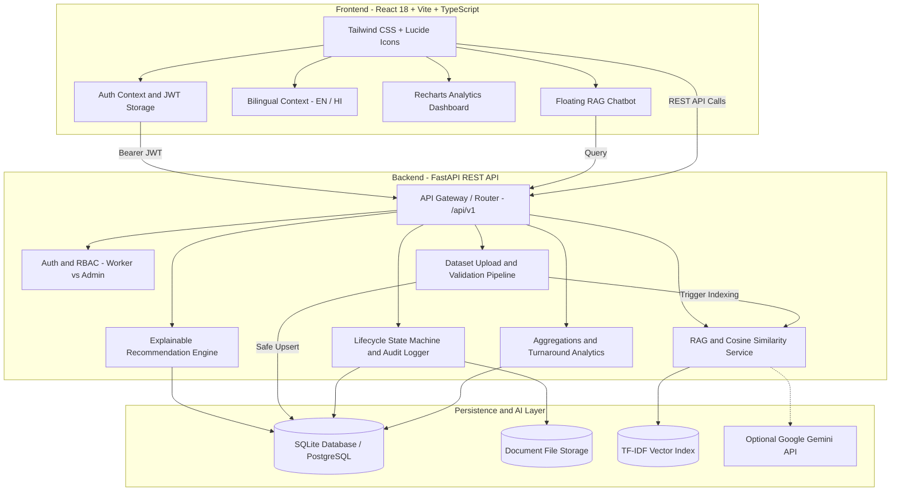

# Informal Worker Benefit Recommendation and Tracking System
### An Academic Mega Project for Social Welfare and Economic Empowerment

[](https://python.org)
[](https://fastapi.tiangolo.com)
[](https://reactjs.org)
[](https://www.typescriptlang.org)
[](https://tailwindcss.com)
[](tests/)

---

## 1. Executive Summary and Problem Statement

In India, over **90% of the total workforce** (approx. 450+ million citizens) operates in the informal and unorganized economy—including construction laborers, street vendors, domestic helpers, rickshaw pullers, waste pickers, and small agricultural workers.

Despite dozens of central and state welfare programs offering healthcare, pensions, insurance, accident cover, and skill grants, informal workers face severe barriers:
1. **Information Asymmetry and Fragmentation**: Schemes are scattered across multiple portals with complex statutory terminology.
2. **Literacy and Language Barriers**: Application instructions are convoluted and rarely available in accessible, simple language.
3. **Complex Eligibility Rules**: Workers do not know if they qualify based on age, income ceiling, occupation, or location.
4. **Lack of Transparency and Status Anxiety**: After applying, workers have zero visibility into their application journey, leading to exploitation by middlemen.

### Project Solution
The **"Informal Worker Benefit Recommendation and Tracking System"** is a complete, production-ready, full-stack web application that solves these challenges through:
- **Explainable AI Recommendation Engine**: Evaluates worker profile against government schemes across 8 weighted criteria (0–100 match score) with full justification.
- **Grounded RAG (Retrieval-Augmented Generation) Chatbot**: Multilingual conversational assistant answering scheme queries strictly using live database records.
- **Dynamic Scheme Dataset Ingestion**: Admins can upload bulk government scheme datasets (CSV/Excel) with schema validation, preview, duplicate detection, and instant re-indexing.
- **End-to-End Application Lifecycle Tracking**: Complete 7-stage state machine with visual milestone timelines, audit logs, and in-app notifications.
- **Inclusive, Worker-Centric UI**: Accessible design, English/Hindi language toggle, 1-Click Viva Demo credentials, and profile completion guidance.

---

## 2. System Architecture



---

## 3. Key Modules and Features

### A. Authentication and Role-Based Access Control
- **Dual User Roles**: `worker` (informal laborer) and `admin` (government welfare officer).
- **Secure Credentials**: Bcrypt salted password hashing with PyJWT authentication.
- **7-Day Session Persistence**: Configured specifically so workers do not repeatedly get logged out.
- **1-Click Viva Quick-Login**: Dedicated quick-login buttons on the login screen for instant evaluation by viva examiners.

### B. Worker Profile and Missing Information Guide
- Captures 14 socioeconomic dimensions: occupation, monthly income, age/DOB, state, district, gender, marital status, family size, disability, education level, BPL/EWS category, and banking status.
- **Dynamic Completion Percentage**: Real-time progress bar that highlights missing fields and guides the worker to 100% completion for optimal scheme matching.

### C. Explainable AI Recommendation Engine
- **Transparent Weighted Scoring (0–100)**:
  - **Occupation Match (25%)**: Exact or category-level matching.
  - **Income Ceilings (20%)**: Income band evaluation.
  - **Age Limits (15%)**: Within min/max statutory bounds.
  - **Geographic Jurisdiction (15%)**: All-India vs State-specific schemes.
  - **Family and Demographics (10%)**: Dependents and marital status criteria.
  - **Disability Inclusivity (5%)**: Dedicated disability benefits matching.
  - **Education Level (5%)**: Qualification thresholds.
  - **Gender Specificity (5%)**: Women-targeted schemes (e.g. maternal/widow benefits).
- **Explainability**: Returns bulleted reasons explaining *why* a scheme was suggested (e.g. *"Your income of Rs 12,000/mo is well below the Rs 15,000 ceiling"*).
- **Interactive ML Architecture Modal**: Displays feature weights, mathematical formulas, and algorithmic pipeline directly in the UI.

### D. Automated Eligibility Checker
- Instantly categorizes any scheme into:
  - `Eligible` (All mandatory criteria satisfied)
  - `Potentially Eligible` (Missing optional documentation or minor criteria)
  - `Not Eligible` (Statutory hard limit breached)
- Clear itemized checklist showing which criteria passed or failed.

### E. Grounded RAG Chatbot
- **Zero Hallucination**: Grounded strictly in live database schemes.
- **TF-IDF Vector Space + Cosine Similarity**: Fast, lightweight matching without requiring heavy external GPU dependencies.
- **Automatic Re-indexing**: Adding a scheme manually or uploading a dataset immediately updates the search index in memory.
- **Optional LLM Mode**: Seamlessly integrates Google Gemini API if `GEMINI_API_KEY` is configured in `.env`.
- **Bilingual Support**: Understands both English and Hindi queries.

### F. Government Scheme Dataset Upload (Admin)
- Supports CSV and Excel (`.xlsx`, `.xls`) uploads.
- **Validation Pipeline**: Checks for mandatory headers, valid numeric ranges (age, income), and data types.
- **Duplicate Detection**: Flags existing scheme names or codes before insertion.
- **Interactive Preview Table**: Shows valid vs invalid rows before executing database writes.
- **Safe Upsert**: Existing schemes can be updated or skipped.
- **Sample Template Download**: Built-in 1-click download of `government_schemes_template.csv`.

### G. Application Lifecycle Tracking and Audit Trail
- **Strict State Machine**:
  `DRAFT` -> `APPLIED` -> `DOCUMENTS_PENDING` -> `DOCUMENTS_VERIFIED` -> `UNDER_REVIEW` -> `APPROVED` -> `BENEFIT_DISBURSED` (or `REJECTED` at any stage).
- **Visual Milestone Timeline**: Color-coded progress line with completion timestamps and officer remarks.
- **Audit Logging**: Every status change, document verification, and administrative action is immutably logged with user ID, IP address, and timestamp.
- **In-App Notifications**: Workers receive real-time notifications on status changes.

### H. Admin Analytics and Operations Dashboard
- **Recharts Data Visualizations**:
  - Application Status Breakdown (Donut Chart).
  - Top Schemes by Application Volume (Horizontal Bar Chart).
  - Worker Occupation Demographics (Bar Chart).
  - 6-Month Application Inflow Trends (Area Chart).
- **Performance Metrics**: Dynamic calculation of average, minimum, and maximum processing turnaround time in days.
- **Data Export**: 1-Click CSV export for Workers, Applications, and Schemes.

---

## 4. Technology Stack

| Layer | Technology | Version | Purpose |
|---|---|---|---|
| **Frontend** | React | 18.2 | Component-based UI library |
| | TypeScript | 5.3 | Static typing and type safety |
| | Vite | 5.1 | High-performance build tool and dev server |
| | Tailwind CSS | 3.4 | Utility-first responsive design |
| | Recharts | 2.12 | Interactive visual data charts |
| | Lucide React | 0.358 | Modern accessible icons |
| | Axios | 1.6 | HTTP client with JWT interceptors |
| **Backend** | FastAPI | 0.110 | High-speed asynchronous REST API |
| | Python | 3.10+ | Core server language |
| | SQLAlchemy | 2.0 | ORM for database abstraction |
| | Pydantic | 2.6 | Data validation and schema serialization |
| | PyJWT | 2.8 | Cryptographic JWT token handling |
| | Bcrypt | 4.1 | Secure one-way password hashing |
| | Scikit-learn | 1.4 | TF-IDF Vectorizer and Cosine Similarity |
| | Pandas and Openpyxl | 2.2 / 3.1 | CSV and Excel dataset processing |
| **Database** | SQLite (Default) | 3 | Zero-configuration local database |
| | PostgreSQL (Ready) | 14+ | Production enterprise relational DB |
| **Testing** | Pytest and HTTPX | 8.0 / 0.27 | Automated endpoint and logic testing |

---

## 5. Directory Structure

```
mega_project_2/
├── .env.example                     # Configuration template
├── README.md                        # Academic documentation and manual
├── run_backend.py                   # Root runner for FastAPI backend
├── backend/
│   ├── informal_benefits.db         # Pre-seeded SQLite database
│   ├── requirements.txt             # Python dependencies
│   ├── uploads/                     # Document storage folder
│   └── app/
│       ├── main.py                  # App entrypoint and lifespan events
│       ├── api/
│       │   ├── deps.py              # Auth dependencies and DB session injector
│       │   └── api_v1/              # Versioned API routes
│       │       ├── api.py           # Master router
│       │       └── endpoints/       # auth, schemes, applications, dataset, etc.
│       ├── core/
│       │   ├── config.py            # Pydantic settings and environment vars
│       │   └── security.py          # Bcrypt hashing and JWT utilities
│       ├── database/                # SQLAlchemy session and base declarative
│       ├── models/                  # User, WorkerProfile, Scheme, Application, etc.
│       ├── schemas/                 # Pydantic schemas for request/response
│       ├── services/                # Recommendation, RAG, Tracking, Analytics, Dataset
│       └── seed/
│           └── seed_data.py         # Database seeder (21 workers, 16 schemes)
├── frontend/
│   ├── package.json                 # Node dependencies
│   ├── vite.config.ts               # Vite configuration with /api proxy
│   ├── tailwind.config.js           # Tailwind CSS configuration
│   └── src/
│       ├── App.tsx                  # Main router and page routes
│       ├── types/index.ts           # Centralized TypeScript definitions
│       ├── context/                 # AuthContext, LanguageContext, ToastContext
│       ├── components/              # Navbar, Sidebar, Timeline, ChatbotWidget, etc.
│       ├── pages/                   # All 18 worker and admin pages
│       └── services/api.ts          # Axios client with JWT auto-attachment
├── sample_data/
│   └── government_schemes_template.csv  # Verified template for dataset upload
└── tests/
    ├── test_auth.py                 # Authentication and registration tests
    ├── test_recommendations.py      # Recommendation engine and eligibility tests
    ├── test_applications.py         # State machine and tracking tests
    └── test_dataset.py              # CSV parsing and preview tests
```

---

## 6. Installation and Setup Guide

### Prerequisites
- **Python 3.10+** (Tested on Python 3.10, 3.11, 3.12, and 3.14)
- **Node.js 18+** and **npm**

### Step 1: Backend Setup
```bash
# Navigate to backend directory
cd backend

# Install dependencies
pip install -r requirements.txt

# Run initial database seed (Seeds 21 workers, 16 schemes, 35+ applications)
python -m app.seed.seed_data
```

### Step 2: Frontend Setup
```bash
# Navigate to frontend directory
cd ../frontend

# Install dependencies
npm install

# Build for production or run dev server
npm run build
```

### Step 3: Launching the Application

#### Option A: Running Both Concurrently

**Terminal 1 (Backend):**
```bash
# From project root
python run_backend.py
# Backend runs at: http://localhost:8000
# Swagger API docs: http://localhost:8000/docs
```

**Terminal 2 (Frontend):**
```bash
# From frontend folder
cd frontend
npm run dev
# Frontend runs at: http://localhost:5173
```

---

## 7. Default Viva Credentials

For viva demonstrations, the login screen includes **1-Click Quick-Login Buttons** that automatically populate credentials:

| Role | Name | Email | Password | Profile Highlights |
|---|---|---|---|---|
| **Admin** | Welfare Officer | `admin@welfare.gov.in` | `Admin@12345` | Full system control, approvals, dataset uploads, analytics |
| **Worker 1** | Ramesh Kumar | `ramesh.worker@demo.in` | `Worker@12345` | Construction Worker, Delhi, 42 yrs, 100% Profile Completion |
| **Worker 2** | Sunita Devi | `sunita.devi@demo.in` | `Worker@12345` | Domestic Helper, UP, 35 yrs, Partial Profile (Missing BPL) |
| **Worker 3** | Rajesh Patel | `rajesh.patel@demo.in` | `Worker@12345` | Street Vendor, Maharashtra, 29 yrs, 92% Profile Completion |

---

## 8. Step-by-Step Viva Demonstration Script

Follow this 5-minute flow during your viva or project presentation to highlight all key requirements:

### Step 1: Worker Login and Profile Completion
1. Open `http://localhost:5173/login`.
2. Click **"Ramesh Kumar (Construction)"** in Quick Demo Logins to populate credentials, then click **Sign In**.
3. View the **Worker Dashboard**:
   - Note the **Profile Completion Card** showing 100% (or 75% for Sunita Devi with missing field suggestions).
   - Note the **Quick Stat Cards**: Recommended Schemes, Active Applications, Documents on File.
4. Click **"My Profile"** in the sidebar to review the 14 socioeconomic parameters.

### Step 2: Explainable AI Recommendation Engine
1. Click **"Recommendations"** in the sidebar.
2. Observe schemes sorted by **Match Score (0–100%)**:
   - **PM-SVANidhi** / **PMSYM** will display high match scores (>85%).
3. Click **"View Explanation Breakdown"** to review the itemized reasons for the recommendation.
4. Click **"View ML Architecture"** button at the top to display the mathematical weights, algorithm explanation, and vector model.

### Step 3: Eligibility Check and Application Submission
1. Click **"Explore Schemes"** in the sidebar.
2. Use the search bar or occupation filter to find a scheme (e.g. *Pradhan Mantri Shram Yogi Maan-dhan*).
3. Click **"View Details & Apply"**:
   - Notice the **Automated Eligibility Card** showing `Eligible` with green checks next to Age, Income, and Occupation.
4. Click **"Apply for this Benefit"**:
   - Select Bank Account Verified and declare consent.
   - Click **"Submit Application"** to generate a new application number (e.g. `APP-2026-XXXXXX`).

### Step 4: RAG Chatbot Demonstration
1. Click the floating **Chat Bubble** in the bottom-right corner.
2. Ask a question:
   - In English: *"What schemes are available for construction workers in Delhi?"*
   - In Hindi: *"construction workers ke liye kya suvidha hai?"*
3. Observe the response grounded directly in the live database schemes with eligibility criteria and application requirements.

### Step 5: Admin Operations and Application Tracking
1. Log out and click **"Admin Officer"** on the login screen, then sign in.
2. View the **Admin Dashboard**:
   - **Donut Chart**: Application Status distribution.
   - **Bar Charts**: Top schemes and worker occupations.
   - **Area Chart**: Monthly application volume trends.
   - **Processing Time Stats**: Real-time average, minimum, and maximum processing turnaround in days.
3. Click **"Applications"** in the admin sidebar:
   - Find the newly submitted application or an existing one in `UNDER_REVIEW`.
   - Click **"Update Status"**, select `APPROVED` or `BENEFIT_DISBURSED`, enter officer remarks, and click **Confirm Update**.

### Step 6: Dataset Upload Module
1. Click **"Dataset Upload"** in the admin sidebar.
2. Click **"Download Sample CSV Template"** to examine the official format.
3. Upload `sample_data/government_schemes_template.csv`:
   - Observe the **Schema Validation Engine** verify all columns and data types.
   - Observe the **Duplicate Detection** flagging existing entries.
   - Review the **Interactive Preview Table**.
4. Click **"Confirm & Import Schemes"**:
   - The database is safely upserted.
   - The RAG Chatbot index is automatically refreshed in memory.

---

## 9. Automated Test Suite

The system includes an automated test suite verifying all critical backend paths:
- **Authentication**: Salted Bcrypt hashing, valid/invalid login, worker registration.
- **Application Tracking**: State machine transition rules, timeline retrieval, permission checks.
- **Dataset Pipeline**: CSV template generation, schema validation, preview cache, duplicate detection.
- **Recommendation Engine**: Weighted scoring logic, 8 criteria weights, eligibility categories.

### Running Tests
```bash
python -m pytest tests/ -v
```

**Results:**
```
tests/test_applications.py::test_status_transition_rules PASSED          [  9%]
tests/test_applications.py::test_application_tracking_by_id PASSED       [ 18%]
tests/test_auth.py::test_password_hashing PASSED                         [ 27%]
tests/test_auth.py::test_admin_login_success PASSED                      [ 36%]
tests/test_auth.py::test_worker_login_success PASSED                     [ 45%]
tests/test_auth.py::test_invalid_login_error_message PASSED              [ 54%]
tests/test_auth.py::test_worker_registration_flow PASSED                 [ 63%]
tests/test_dataset.py::test_sample_csv_template_generation PASSED        [ 72%]
tests/test_dataset.py::test_dataset_upload_preview_and_validation PASSED [ 81%]
tests/test_recommendations.py::test_explainable_recommendation_scoring PASSED [ 90%]
tests/test_recommendations.py::test_eligibility_evaluation_categories PASSED [100%]
======================= 11 passed in 4.75s =======================
```

---

## 10. Security, Ethics and Academic Contributions

1. **Explainable AI (XAI)**:
   - Vulnerable informal workers should never be subjected to opaque "black-box" automated rejections.
   - Every recommendation provides transparent, natural-language criteria matching.
2. **Data Minimization and Privacy**:
   - Sensitive personal information is strictly scoped per worker.
   - Role-based authorization guarantees workers can only view their own applications and profiles.
3. **Auditability and Anti-Corruption**:
   - The immutable `ApplicationStatusHistory` and `AuditLog` ensure that every approval, rejection, and document verification carries the officer ID, timestamp, and audit trail, eliminating administrative opacity.
4. **Resilience and Offline First**:
   - Zero reliance on brittle live external APIs during vivas; the embedded SQLite database contains a rich, realistic seed dataset of 16 official welfare schemes and 21 workers.